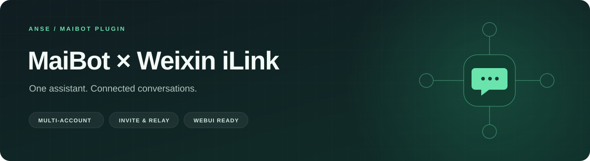
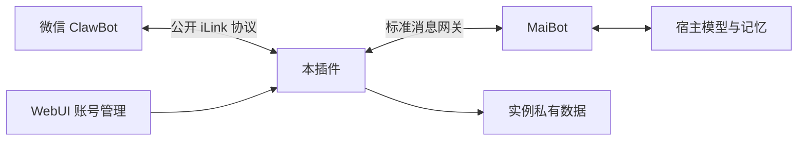

<div align="center">



# 微信 iLink · MaiBot 插件

**把 MaiBot 带进微信，让邀请、交流和消息转达自然发生。**


[快速开始](#快速开始) · [功能概览](#功能概览) · [使用方式](#使用方式) · [常见问题](#常见问题)

</div>

---

基于腾讯公开的 [iLink HTTP 协议](https://github.com/Tencent/openclaw-weixin)，为 MaiBot 提供多账号微信私聊通道。一个助手可以连接多个独立授权账号，在统一的 WebUI 中完成绑定、用户介绍、昵称管理与分组转达。

这是社区维护的独立插件，**不是腾讯官方插件或认证产品**。连接的是微信 ClawBot 通道，当前支持私聊，不提供微信群聊接入。

## 功能概览

| 能力 | 使用体验 |
| :--- | :--- |
| **多账号接入** | 扫码连接多个账号，独立保存授权、消息游标与去重状态；复用同一个 MaiBot。 |
| **WebUI 管理** | 绑定管理员、绑定新用户、查看介绍、编辑昵称和移除接入，集中在“微信账号管理”。 |
| **自然语言邀请** | 管理员在聊天中介绍朋友，Bot 返回绑定二维码；支持取消、过期提示和重新邀请。 |
| **图片与表情包** | 接收图片并交给宿主识图；回复支持文字、图片与表情素材，GIF 保留原始字节。 |
| **语音输入** | 使用微信随消息提供的转写文字；未提供转写时明确提示，不自行猜测内容。 |
| **分组消息转达** | 开启后，同组成员可以让 Bot 为彼此转达文字，接收方聊天历史同步留档。 |
| **可选共享记录** | 每组独立控制近期转达记录共享，只向当前有权限的成员提供。 |
| **回复窗口管理** | 显示用户的 24 小时回复窗口；过期或未知时拦截发送，重启不续期。 |

## 快速开始

### 1. 安装插件

**运行条件**：MaiBot 1.3.14+、插件 SDK 2.16+。当前验证环境为 Windows；账号注册锁依赖 `msvcrt`，暂不支持直接在 Linux / macOS 运行。版本兼容范围以 [_manifest.json](_manifest.json) 为准，较新的宿主版本不代表均已验证。

在 **MaiBot 实例根目录**执行：

```powershell
git clone https://github.com/Andself/maibot-ilink-plugin.git plugins/anse.ilink
```

使用运行 MaiBot 的同一个 Python 环境安装依赖。以下命令中的解释器路径需替换为实际路径：

```powershell
uv pip install --python "<运行 MaiBot 的 python.exe 路径>" -r plugins/anse.ilink/requirements.txt
```

插件依赖为 `qrcode`、`Pillow` 和 `cryptography`，同时在 Manifest 中声明。插件本身不需要额外配置模型 API Key，也不需要修改 MaiBot 核心。

### 2. 绑定管理员

启用插件并重载 MaiBot，进入：

**WebUI → 插件扩展 → 微信账号管理 → 绑定管理员**

用管理员微信扫码，并按页面提示完成确认或配对验证码。管理员绑定成功后，页面会显示“绑定新用户”。

> 后台操作依赖 MaiBot WebUI 的登录权限。已有管理员不会被首次绑定入口替换。

### 3. 开始对话

在微信中向已绑定的 ClawBot **主动发送一条消息**，建立回复窗口，然后正常聊天。

邀请朋友时，先提供一句人物介绍，生成二维码后让朋友使用自己的微信扫码，再主动发一条消息。多账号共用助手，不共用各自的登录凭据。

<details>
<summary>可选：使用命令行绑定</summary>

在插件目录中，使用 MaiBot 的宿主 Python 执行：

```powershell
# 绑定普通账号
python login.py

# 显式绑定或更换管理员：请确认扫码的是管理员本人
python login.py --admin
```

这里的 `python` 必须指向宿主解释器。二维码与登录状态保存在实例私有数据目录，成功后删除二维码。WebUI 绑定不需要启动此脚本。

</details>

## 使用方式

### 邀请朋友，先认识再聊天

管理员可以自然地说：

> 我想把你介绍给我的朋友认识一下。

Bot 会先询问对方是谁，再接收一句介绍，例如：

> 他叫小林，是我的朋友，喜欢旅行和摄影。

介绍的填写步骤由插件接收，**不经过普通聊天历史和自动人物记忆链路**。只有好友完成扫码绑定后，描述才保存为该用户的背景资料；取消、失败或过期不会创建这份人物资料。

背景会标明介绍来源，供后续对话参考，不作为权限依据，也不会改写用户原始发言。

- 介绍填写窗口约 **10 分钟**，二维码等待最长约 **5 分钟**。
- 后台支持取消、二维码过期提示及重新生成；服务重启后需重新生成等待中的二维码。
- `/invite`、`/cancel-invite` 是明确命令入口；自然语言邀请由宿主模型理解后调用插件。
- 权限在执行层校验，昵称和模型声称的身份不能授予管理员权限。

### 转达消息，限定在双方所属的组内

进入 **微信账号管理 → 设置转达组**，开启转达功能，建立分组并选择成员。默认关闭，每组支持 **2–16 人**。

> 帮我告诉小林，今晚八点见。

只有共享至少一个组的两个不同用户才能互相转达；管理员也没有跨组特权。分组关系不传递，重名或目标不明确时应先确认。

转达以 Bot 身份发送，并附上发起人署名。消息经宿主正常发送链路存档，同步到接收方聊天上下文，不会只调用微信接口而遗漏系统记录。

接收方窗口失效时明确失败，**不排队、不自动补发**。网络结果不确定时也不自动重试，避免重复投递；每位发起人至少间隔 10 秒。

### 共享转达记录，由每个组自己决定

每组可单独开启 **“共享转达记录”**，默认关闭。

开启后，仅保存后续明确转达的正文、双方身份、时间与提交状态；不复制双方私聊、人物介绍或凭据。当前成员可在对话中使用该组最近 **30 天**的记录，新加入成员也可访问仍有效的历史记录。

- 权限按当前账号、成员关系、总开关和组开关重新校验。
- 改组名保留记录归属；删组后新建同名组不会继承旧记录。
- 每次最多提供 6 条近期记录，单条上下文最多 600 字；不包含语义向量检索。
- 关闭共享会停止继续提供记录，但不能撤回已经发送或进入其他聊天历史的内容。

### 24 小时回复窗口

**已绑定 ≠ 当前可以接收 Bot 回复。**

微信 ClawBot 仅接收用户发消息后 24 小时内的回复。插件以真实入站消息的创建时间计算窗口，发送消息、扫码、轮询和重启都不会续期。

| 后台状态 | 含义与处理 |
| :--- | :--- |
| **有效** | 本地判断仍在窗口内；页面显示到期时间，实际能否发送仍由微信接口决定。 |
| **已过期** | 用户需要先给 Bot 发一条新消息。 |
| **未知** | 没有可靠时间记录或凭据已变化，同样需用户先发消息。 |

文字、图片、二维码、转达均在最终发送前统一检查。新绑定用户的欢迎消息也会等待其先发言，再走正常发送与存档流程。

**接口接受表示已提交，不等于微信客户端已收到或用户已读。**

## 架构与数据



模型负责理解自然语言与选择功能，插件负责真实身份、管理员权限、转达组权限和回复窗口的执行校验。用户身份由宿主会话解析，不接受模型自行指定身份。

凭据与状态保存在标准实例布局的 `depends-data/anse.ilink/`，与源码分开：

| 数据 | 用途 |
| :--- | :--- |
| 账号授权、白名单、管理员设置 | 连接与权限管理 |
| 消息游标、去重记录、回复上下文 | 接收进度与有效窗口恢复 |
| 本地昵称、邀请介绍 | 显示与用户背景 |
| 欢迎状态、转达组与独立共享账本 | 防重复、分组与近期记录 |

移除普通账号会停止接入、清除本地回复上下文并移除转达组权限；昵称、介绍、历史和本地凭据保留，方便重新扫码接入。**本地移除不等于解除微信侧绑定**，也不会自动恢复旧转达组权限。

MaiBot 的模型、人设及部分记忆资源仍由宿主管理，本插件**不提供账号级长期记忆隔离**。部署时请保持标准 `plugins/anse.ilink` 目录布局。

## 当前支持边界

- **私聊**：已实现；微信群聊未接入。
- **图片 / GIF**：按图片消息发送表情素材；不承诺微信原生收藏表情协议或所有客户端的动画表现。
- **语音**：接收依赖微信提供转写，不包含独立 ASR；不提供可依赖的原生语音回复。
- **自然语言管理**：依赖宿主模型正确选择工具；执行层会重新校验权限，不能把模型识别能力视为绝对保证。
- **平台**：Windows；其他系统尚未适配。

图片限制：单图 8 MB、每条最多 4 张、入站图片总计 10 MB；最多 200 帧、2000 万像素。仅访问允许的微信 / WeChat HTTPS CDN，不把 Bot 凭据传给 CDN；不自动收藏普通图片到全局表情库。

## 常见问题

<details>
<summary><strong>扫码绑定成功，为什么还没有回复？</strong></summary>

先在微信中主动发一条消息，再确认 MaiBot 和插件正在运行。后台显示“已绑定”只说明账号已接入，不代表24小时回复窗口有效。图片或语音问题还需检查宿主识图配置，以及微信是否附带语音转写。

</details>

<details>
<summary><strong>Bot 能给未主动发言的人发欢迎或转达消息吗？</strong></summary>

不能依赖这种行为。当前版本统一要求有效窗口和回复上下文；欢迎任务等待首条有效消息，转达在目标窗口失效时拒绝发送。

</details>

<details>
<summary><strong>为什么普通用户不能邀请朋友？</strong></summary>

邀请和取消邀请需要真实管理员身份，普通用户无法通过聊天、昵称或自称管理员获得权限。后台由已登录的 WebUI 用户管理。

</details>

<details>
<summary><strong>升级后窗口变成“未知”，需要重新绑定吗？</strong></summary>

通常只需该用户重新发一条消息。缺少可靠时间来源的旧记录不会被直接当作当前活跃状态，升级也不会替用户续期。

</details>

## 开发与验证

```powershell
# 在插件目录，使用宿主 Python 运行离线回归
python test_adapter.py

# 构建仅包含明确白名单文件的源码包
python build_release.py
```

测试覆盖身份、邀请、过期、昵称、媒体、转达权限、共享记录与24小时窗口，不发送真实微信消息。通过离线测试不等于微信实际投递验收。

发布包不包含登录凭据、运行配置或私有状态。当前为源码安装方式，尚未发布 MaiBot 插件市场。管理员 `/image-test` 可辅助验证图片和 GIF；`/voice-test` 仅为历史实验入口，不建议用于正常对话。

---

<div align="center">

由 [Andself](https://github.com/Andself) 维护 · 基于 [Tencent / openclaw-weixin](https://github.com/Tencent/openclaw-weixin) 协议实现

</div>
